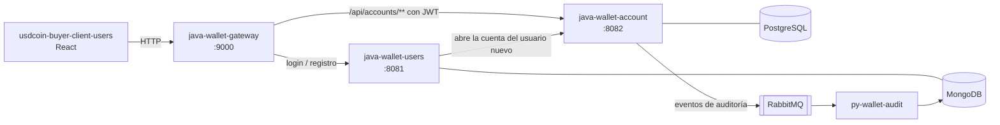

# java-wallet-account

[](https://github.com/josejps84/java-wallet-account/actions/workflows/ci.yml)

Servicio de **cuentas** de la billetera: abre cuentas, registra depósitos y retiros, consulta saldos y permite a los administradores editar cuentas. Cada cambio publica un evento de auditoría en RabbitMQ.

Es parte de un sistema de microservicios:



| Repo | Rol |
|---|---|
| [java-wallet-gateway](https://github.com/josejps84/java-wallet-gateway) | Punto de entrada único; valida el JWT y enruta |
| [java-wallet-users](https://github.com/josejps84/java-wallet-users) | Registro, login y emisión de JWT |
| **java-wallet-account** | Cuentas y movimientos (este repo) |
| [py-wallet-audit](https://github.com/josejps84/py-wallet-audit) | Guarda los eventos de auditoría |
| [usdcoin-buyer-client-users](https://github.com/josejps84/usdcoin-buyer-client-users) | Interfaz web |

## Stack

Java 25 · Spring Boot 4.1 (Web MVC, Security, Data JPA, Validation, AMQP) · PostgreSQL 17 + Flyway · RabbitMQ 4 · JJWT · Lombok · JUnit 5, Mockito y Testcontainers.

## Arquitectura

Arquitectura hexagonal (puertos y adaptadores). El dominio no conoce Spring ni la base de datos:

```
src/main/java/com/wallet/account
├── domain
│   ├── model            Account, Caller, AccountEvent, AccountStatus, excepciones
│   └── ports
│       ├── in           Casos de uso: crear, depositar, retirar, consultar, listar, editar
│       └── out          AccountRepositoryPort, AccountEventPublisherPort
├── application/services AccountService: implementa los casos de uso (@Transactional)
└── infrastructure
    ├── adapters/in/web       AccountController, DTOs, GlobalExceptionHandler
    ├── adapters/out/db       Entidad JPA, repositorio Spring Data, adaptador Postgres
    ├── adapters/out/messaging Publicador de eventos a RabbitMQ
    ├── security              JwtAuthenticationFilter
    └── config                Spring Security y RabbitMQ
```

## Reglas de negocio

- **Autenticación:** todos los endpoints exigen un JWT válido (`Authorization: Bearer ...`), incluso si se llaman sin pasar por el gateway. Del token salen el `userId` y el rol (`CUSTOMER` o `ADMIN`).
- **Autorización:**
  - Un cliente solo ve y mueve sus propias cuentas. Una cuenta ajena responde **404** para no revelar que existe.
  - Solo un administrador puede editar cuentas o abrir cuentas para otro usuario.
  - Un administrador ve todas las cuentas.
- **Números de cuenta:** se generan en el servidor (UUID), así que un cliente no puede sobrescribir una cuenta existente.
- **Dinero:** se maneja con `BigDecimal` de punta a punta (`NUMERIC(19,4)` en la base). No se permite saldo negativo; hay además un `CHECK` en la base.
- **Concurrencia:** depósitos y retiros bloquean la fila (`SELECT ... FOR UPDATE`), así que dos retiros simultáneos no pueden dejar el saldo mal.
- **Auditoría:** los eventos se publican **después del commit**. Si la operación hace rollback no se publica nada, y una caída de RabbitMQ no rompe la operación.

## API

Base: `/api/accounts`. Todas las respuestas son JSON.

| Método | Ruta | Quién | Descripción |
|---|---|---|---|
| `GET` | `/api/accounts?page=0&pageSize=20` | todos | Lista paginada (admin: todas; cliente: las suyas). `pageSize` entre 1 y 100 |
| `POST` | `/api/accounts/new` | todos | Abre una cuenta. Body opcional: `{ "currency": "EUR" }`; un admin puede agregar `"userId"` |
| `POST` | `/api/accounts/deposit` | dueño o admin | `{ "accountId": "...", "amount": 100.50 }` |
| `POST` | `/api/accounts/withdraw` | dueño o admin | `{ "accountId": "...", "amount": 20 }` |
| `GET` | `/api/accounts/balance/{accountId}` | dueño o admin | `{ "accountNmbr", "balance", "currency" }` |
| `PUT` | `/api/accounts/edit` | admin | `{ "accountNmbr": "...", "currency": "EUR", "status": "INACTIVE" }` |

Ejemplo de cuenta (`AccountDto`):

```json
{
  "accountNmbr": "e79efbaa-99dd-42ce-98e7-176c77df3458",
  "currentBalance": 100.0000,
  "currency": "USD",
  "status": "ACTIVE",
  "userId": 1,
  "dateCreation": "2026-11-20T18:29:24.038Z",
  "lastUpdate": "2026-11-20T18:29:25.443Z"
}
```

Los errores siguen [RFC 9457](https://www.rfc-editor.org/rfc/rfc9457) (`ProblemDetail`). El mensaje para el usuario va en `detail`:

```json
{ "status": 400, "title": "Bad Request", "detail": "Saldo insuficiente", "instance": "/api/accounts/withdraw" }
```

| Código | Cuándo |
|---|---|
| 400 | Validación, monto no positivo, saldo insuficiente |
| 401 | Sin token o token inválido/expirado |
| 403 | La operación requiere ser administrador |
| 404 | La cuenta no existe o no es del usuario |

## Eventos de auditoría

Se envían como JSON al exchange `audit_exchange` (routing key `audit_routing_key`, cola `audit_queue`):

```json
{
  "eventId": "729571a9-34d0-4f62-b497-03429480acb0",
  "type": "DEPOSIT",
  "accountNmbr": "e79efbaa-99dd-42ce-98e7-176c77df3458",
  "accountUserId": 1,
  "performedBy": 1,
  "amount": 100.10,
  "balance": 100.10,
  "occurredAt": "2026-11-20T18:29:25.443Z"
}
```

`type` puede ser `ACCOUNT_CREATED`, `ACCOUNT_UPDATED`, `DEPOSIT` o `WITHDRAWAL`.

## Configuración

Por variables de entorno. Para correrlo en local se pueden poner en un archivo `.env` en la raíz del repo (está en `.gitignore`; ver [`.env.example`](.env.example)).

| Variable | Obligatoria | Default | Descripción |
|---|---|---|---|
| `JWT_SECRET` | sí | — | Secreto HMAC compartido con users y gateway (mínimo 32 bytes) |
| `DB_PASSWORD` | sí | — | Contraseña de PostgreSQL |
| `RABBITMQ_PASSWORD` | sí | — | Contraseña de RabbitMQ |
| `DB_URL` | no | `jdbc:postgresql://localhost:5432/accounts` | URL JDBC |
| `DB_USERNAME` | no | `admin` | Usuario de PostgreSQL |
| `RABBITMQ_HOST` / `RABBITMQ_PORT` | no | `localhost` / `5672` | Broker |
| `RABBITMQ_USERNAME` | no | `admin` | Usuario de RabbitMQ |
| `SERVER_PORT` | no | `8082` | Puerto HTTP |

## Ejecutar en local

Requisitos: **JDK 25** (Lombok todavía no soporta versiones más nuevas) y Docker.

```sh
# 1. Infraestructura
docker run -d --name wallet-postgres -p 127.0.0.1:5432:5432 \
  -e POSTGRES_DB=accounts -e POSTGRES_USER=admin -e POSTGRES_PASSWORD=<password> postgres:17-alpine
docker run -d --name wallet-rabbitmq -p 127.0.0.1:5672:5672 \
  -e RABBITMQ_DEFAULT_USER=admin -e RABBITMQ_DEFAULT_PASS=<password> rabbitmq:4-alpine

# 2. Configuración
cp .env.example .env   # completar JWT_SECRET, DB_PASSWORD y RABBITMQ_PASSWORD

# 3. Arrancar (Flyway crea el esquema)
./mvnw spring-boot:run
```

El esquema lo administra Flyway (`src/main/resources/db/migration`). Una migración aplicada no se edita: los cambios van en un archivo `V<n>__*.sql` nuevo.

### Docker

```sh
docker build -t wallet-account .
docker run -p 8082:8082 -e JWT_SECRET=... -e DB_URL=jdbc:postgresql://<host>:5432/accounts \
  -e DB_PASSWORD=... -e RABBITMQ_HOST=<host> -e RABBITMQ_PASSWORD=... wallet-account
```

La imagen compila con Maven en una primera etapa y corre con un JRE 25 como usuario no root.

## Tests

```sh
./mvnw test
```

- **Unitarios:**
  - Dominio (`Account`).
  - `AccountService`: autorización, eventos.
  - Filtro JWT, mapeo a la base y publicador de eventos (después del commit; nada si hay rollback).
- **Integración** (`AccountApplicationTests`): levanta PostgreSQL y RabbitMQ con Testcontainers y prueba:
  - Seguridad de punta a punta.
  - 10 retiros concurrentes que nunca sobregiran.
  - Los mensajes JSON reales en la cola.
  - Las restricciones de la base.

  Si no hay Docker disponible, se saltan solos.

El [workflow de CI](.github/workflows/ci.yml) corre `./mvnw verify` en cada push a `main` y en cada pull request.
